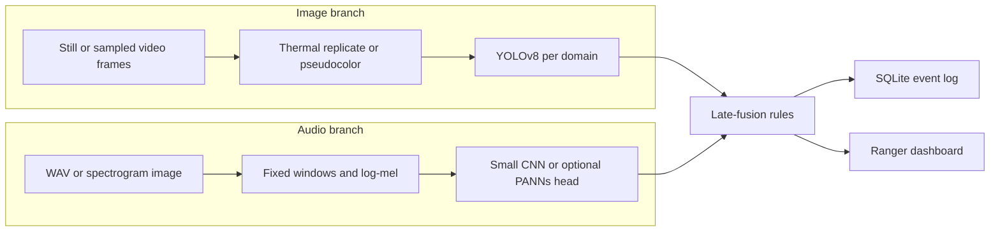

# GuardianEye

GuardianEye is a two-modality review tool for wildlife rangers. It looks for **indicators** in camera-trap and aerial-thermal images, and in short audio clips, then combines those indicators at decision time. A human, a vehicle, or a gunshot-like sound is not a finding that someone was poaching.

Video is not a third modality. Frames are sampled from it and sent through the image branch.

This is an academic mini-project (Multimodal AI, Group 27).

**Proof-of-concept. Indicators, not confirmed poaching.**

## Architecture



Image classes are `human`, `vehicle`, `animal`, and empty frames (no boxes). Audio classes are `gunshot` and `background`. Animal boxes are recorded and are not treated as a poaching indicator.

Late fusion:

- **HIGH** — a human or vehicle detection and a gunshot score, both at or above threshold, inside the time window. This is the default alert.
- **MEDIUM** — exactly one of those indicators, or both indicators outside the time window.
- **LOW** — neither.

If only one modality is uploaded, the score still comes back, but the threshold is stricter and the level cannot be HIGH. Every event is logged, including ones that do not alert.

There are no public datasets with time-aligned image and audio of the same incident. Fusion evaluation builds **synthetic pairs** from labelled scenarios. That is a proxy protocol, not field validation. The dashboard and `reports/fusion/` say so.

## Setup

Python 3.11 or newer. CPU is enough for the demo and the smoke train.

```bash
make setup
make test
```

`make setup` creates `.venv`, installs the pinned stack, and generates a tiny synthetic sample tree so the pipeline runs before you have the real archives. Sample images are colored blocks and sample clips are synthesized impulses and noise. They are not field data.

Useful targets:

| Target | What it does |
| --- | --- |
| `make data` | Download whatever URLs you have filled in, then prepare splits and EDA |
| `make train-image` | YOLOv8, one run per domain |
| `make train-audio` | Cross-site and in-domain audio runs |
| `make train-image SMOKE=1` | One short image epoch on the prepared set |
| `make train-audio SMOKE=1` | One short epoch of every audio experiment |
| `make eval` | Write `reports/` from the checkpoints that exist |
| `make serve` | API on port 8742 and the dashboard at `/dashboard` |
| `make lint` | Ruff and mypy |

Copy `.env.example` to `.env` if you want Hub downloads. The service starts with no secrets.

## Data

See `data/README.md`. URLs in `configs/data.yaml` are `TODO` on purpose. `scripts/download_data.py` skips those entries and will not invent a link. When you set a URL and a sha256, the checksum is checked.

Image sources: BIRDSAI (aerial thermal, primary), Caltech Camera Traps (including empty frames), Snapshot Serengeti (supporting). Audio sources: the Belize tropical-forest gunshot set (primary) and the Chu Mom Ray Vietnam set (cross-site). Doull et al. is not required.

Splits are by domain and by site, not by a shuffled pool:

- Image metrics are written separately for `aerial_thermal` and `camera_trap_rgb`.
- Audio trains on one site and tests on the other, in both directions, plus an in-domain control for each site.
- Empty images and background clips stay in the training set. Rare box classes are oversampled upward. Audio uses class-weighted loss.

## Training and evaluation

Training is meant for a GPU notebook, not the deploy host. `notebooks/train_image.ipynb` and `notebooks/train_audio.ipynb` clone the repo, call the same scripts, and upload checkpoints to a Hugging Face model repo.

```bash
make train-image
make train-audio
make eval
```

`make eval` writes only what it can measure:

- `reports/image/<domain>.json` — mAP50, mAP50-95, per-class precision and recall, small-object recall, empty-frame false-positive rate
- `reports/audio/experiments.json` — precision, recall, F1, false-positive rate, and a PR curve for each experiment
- `reports/fusion/proxy.json` — image-only vs audio-only vs fused on the synthetic pairs, plus a failure-analysis list
- `reports/latency.json` — per-stage and end-to-end CPU time for one event
- `reports/INDEX.md` — generated from those files

If a checkpoint is missing, the JSON says the run was not evaluated. It does not fill in a number. The dashboard reads the same files. `reports/RESULTS_TEMPLATE.md` is a blank table that shows where to copy the final figures for a write-up.

## Serving

```bash
make serve
```

- Dashboard: `http://127.0.0.1:8742/dashboard`
- `GET /health`
- `GET /model-info` — says whether each checkpoint loaded, and whether it is a smoke run, a trained run, or missing
- `POST /events` — multipart `visual` and/or `audio`, plus `domain`, `weight_profile` (`balanced`, `night`, `wind`), and `decision_mode` (`rules` or `weighted`)
- `GET /events` — the audit log, alerts and non-alerts

Night weighting favours audio. Wind weighting favours vision. In rules mode those weights change the numeric score; HIGH still requires both indicators. Weighted mode maps the score onto the three levels and still refuses HIGH when a modality is missing.

The dashboard can load the prepared sample pair, draw boxes, show the waveform and a log-mel image, and run image-only, audio-only, and fused decisions on that same upload.

## Docker and Hugging Face

```bash
docker compose build
docker compose up
```

The image is CPU-only, runs as a non-root user, and health-checks `/health`. Steps for a Hugging Face Docker Space, including the required README front matter and the weight-repo layout, are in `deploy/huggingface/README.md`. Render or Railway can use the same Dockerfile.

Set `HF_MODEL_REPO` to download checkpoints at startup. Leave it empty to run on local files, or with no weights at all.

## Configuration

Everything tunable is in `configs/`:

| File | Contents |
| --- | --- |
| `data.yaml` | Paths, thermal mode, window length, sample rate, label map, download TODOs |
| `image.yaml` | YOLOv8 size, epochs, augmentation, oversampling, smoke overrides |
| `audio.yaml` | CNN vs PANNs, class-weighted loss, SpecAugment, the four experiments |
| `fusion.yaml` | Thresholds, time window, weight profiles, alert levels |
| `serve.yaml` | Port 8742, database path, latency target |

Seeds default to 27.

## Big Data Analytics coursework

`bda/guardianeye_bda_analysis.py` is the Big Data Analytics artefact. It opens a local PySpark session and aggregates prepared image manifests, audio windows, site-stratified splits, synthetic proxy pairs, and the SQLite event log. The written report is `docs/BDA_Project_Report_2026_2027.docx`, with a copy at `BDA_Project_Report_2026_2027.docx`. The submission slides are `docs/BDA_Project_Presentation_2026_2027.pptx`, with a copy at `BDA_Project_Presentation_2026_2027.pptx`.

```bash
.venv/bin/python bda/guardianeye_bda_analysis.py
```

The job writes `reports/bda/summary.json` and `reports/bda/aggregation.csv`. Those files count the prepared metadata. They are not model metrics. A Java runtime is required for the Spark session. Download URLs in `configs/data.yaml` stay `TODO`.

## Limitations

- No public dataset here has a poacher label, and none aligns an image with the audio of the same moment. Fusion scores from `build_paired_events.py` are a **synthetic proxy**.
- Aerial thermal imagery and camera-trap RGB are different domains. A single pooled image number would hide that. The code refuses to train them as one headline run.
- Belize and Vietnam audio do not match. The cross-site experiments exist to show that gap, not to average it away.
- Gunshot-like impulses (thunder, branch snaps, rain) can look like the positive audio class. Empty frames and canopy-sized people are the matching failure modes on the image side. The proxy failure analysis lists those scenarios when the models are loaded.
- Smoke checkpoints trained on the synthetic sample tree only prove that the scripts run. `/model-info` marks them as `smoke`. Do not report them as field performance.
- PANNs / YAMNet is a config switch. You supply the checkpoint. The repo does not download those weights and does not invent embedding labels such as chainsaw.
